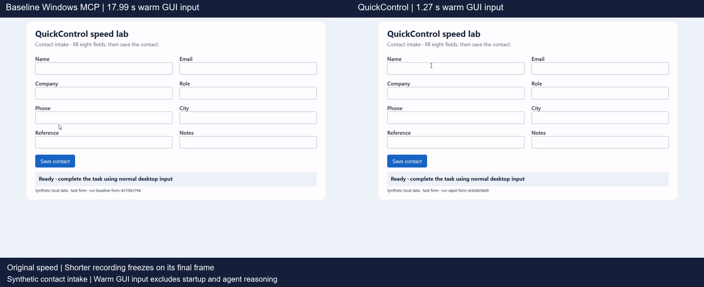

<h1 align="center">QuickControl</h1>

<p align="center"><b>Faster Windows control for AI agents.</b><br>
Enter text and fill stable forms with fewer waits and tool calls.</p>

In local GUI tests, an eight-field form fell from **17.99 to 1.27 seconds**.
A real Notepad edit and save fell from **13.79 to 2.83 seconds**. Each number
is the median of three exact-outcome passes per profile. Startup, navigation
and agent reasoning are excluded; gains vary by task.

[](assets/quickcontrol-demo.mp4)

[Watch the video](assets/quickcontrol-demo.mp4) | [Results and failed experiments](measurements/rd-report.md)

Built on [CursorTouch's Windows MCP](https://github.com/CursorTouch/Windows-MCP).
Windows MCP provides desktop tools, screenshots, accessibility and control
ownership. I added bounded native Unicode input, observed form traversal,
validated action sequences, connection reuse, per-call timings and real GUI
outcome checks. The default server profile includes these improvements.

The QuickControl server profile also uses **double-tap Escape** for deliberate
takeover, ignores accidental physical input while AI control is active, removes
the old shortcut banner, and captures the primary monitor by default.

## Run

Requires Windows, [uv](https://docs.astral.sh/uv/), and an interactive desktop.
The measured server version is Windows MCP 0.8.8 on Python 3.14.

```powershell
git clone https://github.com/EnesYilmazcode/QuickControl.git
cd QuickControl
uv run --python 3.14 --with mcp python quickcontrol.py --batch '@benchmark.json'
```

By default, QuickControl reads the `windows-mcp` entry from
`~/.codex/config.toml`. If you already use Windows MCP there, no configuration
change is needed. Otherwise, save this as `server.local.toml`:

```toml
[mcp_servers.windows-mcp]
command = 'uvx'
args = ['--python', '3.14', 'windows-mcp==0.8.8', 'serve']
startup_timeout_sec = 120
```

Pass it with `--config server.local.toml`. Use an absolute executable path if
`uvx` is not on your PATH. QuickControl does not change your MCP registration.

## One call or a sequence

Check control ownership:

```powershell
uv run --with mcp python quickcontrol.py ControlStatus
```

Capture one display using the included argument file:

```powershell
uv run --with mcp python quickcontrol.py Screenshot '@screenshot.json'
```

A batch is an array of tool calls. The included `benchmark.json` checks ownership
and captures three screenshots:

```json
[
  {"name": "ControlStatus"},
  {"name": "Screenshot", "arguments": {"display": [0]}},
  {"name": "Screenshot", "arguments": {"display": [0]}},
  {"name": "Screenshot", "arguments": {"display": [0]}}
]
```

Calls run in order on one initialized session. An MCP error stops the remaining
calls. A ControlStatus response that is not `ready` also stops the batch.
Completed actions stay completed; nothing is automatically retried or rolled
back. Upstream ownership checks still apply to desktop input.

Use `@file.json` arguments in PowerShell to avoid native-command quoting issues.
Run without a tool name to list the server's tool schemas.

## Faster input and stable workflows

The default `server.py` profile adds:

- Native Unicode input in bounded chunks, including emoji, literal braces and
  multiline text. It leaves the clipboard untouched and keeps the original
  pointer-focus wait. Check the visible result before continuing.
- `FillForm(loc=[x,y], fields=[...], submit=False)` for a previously observed,
  empty form with a known linear Tab order. It focuses once and enters values
  with Tab between them. Submission is off by default. Enable it only when the
  next control after the final field is the observed save button.
- `Sequence(actions=[...])` for up to 16 Click, Type or Shortcut calls on stable
  targets. The entire plan is validated first, with 4,000 text characters total
  and a 30-second budget for starting further actions. It stops on error and
  never retries completed input. An in-flight action is not forcibly timed out.

Both tools use the existing control gate. Native input checks ownership and
foreground changes between chunks. Worker context follows the existing UIA
thread, and cancellation drains that worker before control is released.
Navigation and layout changes still require a fresh observation.

| Verified task | Baseline median | QuickControl median | Speedup |
| --- | ---: | ---: | ---: |
| Eight-field form | 17.99 s | 1.27 s | 14.1× |
| Notepad Unicode JSON edit/save | 13.79 s | 2.83 s | 4.9× |
| Search and update ticket | 6.97 s | 4.13 s | 1.7× |
| Replace plain-text note | 2.35 s | 2.08 s | 1.1× |

The form comparison includes a change from repeated pointer edits to observed
keyboard traversal. These are small local tests, not universal speed claims.
See the [R&D report](measurements/rd-report.md) for all samples, failures and
reproduction steps. `baseline_server.py` preserves the earlier typing behavior.

## Deliberate control and one monitor

Use the QuickControl server profile to change the desktop behavior:

```powershell
uv run --with mcp python quickcontrol.py --config profile.example.toml Screenshot
```

Run from this directory, or use an absolute path to `server.py` in the profile.
For a persistent MCP connection, point your MCP client's Windows MCP registration
at `uv run --python 3.14 --with windows-mcp==0.8.8 python /absolute/path/server.py serve`.
Restart that server connection after changing its registration; an already-running
process keeps its existing behavior.

While the blue control indicator is active, ordinary physical mouse movement,
clicks, wheel events, and keys are ignored. Press and release **Escape twice
within 500 ms** to hand control back. Holding Escape does not count as two taps;
an intervening key or a new control lease resets the sequence. Injected AI input
continues normally. The old Ctrl+Alt+Shift+Backspace banner is removed; the blue
edge and cursor indicator remain.

Double Escape cancels the active input lease through the upstream handoff path,
releases AI-held inputs, and returns control to you. It does not terminate the
server process. Upstream idle cooldown, lease expiry, and fault-release behavior
remain in place. A stopped watchdog, broken indicator, or stale hook still
releases control instead of waiting for Escape. Input outside an active lease
follows upstream behavior.

Screenshot and Snapshot capture the **primary monitor** when no display or region
is supplied. Other monitors remain available explicitly:

```json
{"display": [1]}
{"display": [0, 1]}
{"region": [1920, 0, 2120, 200]}
```

These examples select the second display, both displays, and a region in virtual
desktop coordinates. Check your display inventory before choosing indices or
coordinates. The actual primary monitor is detected rather than assumed to be
display zero. Single-monitor capture does not confine automation input to that
monitor. Tool descriptions report the new default.

## Results you can inspect

Each run gets its own directory under `~/.codex/tmp/windows-mcp/`:

```text
20261107-002301-271d7601/
  session.json    connection startup time
  calls.json      arguments, timings, text, image paths, and error flags
  001-1.png       a screenshot from one call
```

Use `--output artifacts` to keep runs in the project directory, or `--timeout 30`
to change the per-call timeout in seconds. Calls are limited to 100 per batch.
Logs include tool arguments and returned text; screenshots contain what was on
the desktop. Local artifacts are excluded from Git.

When using an agent with directly exposed Windows MCP tools, use those tools.
They already keep a connection open. QuickControl's batch client helps when
calling the server through individual shell commands.

## What helped

| Change | Local result |
| --- | --- |
| Reuse one connection for three captures | 25.057 s to 10.142 s, 59.5% less wall time |
| Use a screenshot when a UI tree is unnecessary | Screenshot median 0.313 s; one full snapshot 22.791 s |
| Crop a known window | 92.5% smaller image payload; no capture-time improvement in this run |
| Paste short plain text, experimental | Three-field fill mean 6.86 s to 5.58 s, 18.6% less time |

These are small local measurements, not a claim that all computer-use tasks run
60% faster. The snapshot returns more information than a screenshot. The batch
comparison has one completed round; the typing comparison has two runs per
profile. See [measurements](measurements/README.md) for the setup and saved values.

For ordinary desktop work, start with a screenshot of the relevant display.
Crop when the target is known, and request the accessibility tree when you need
control identities. Cropped image coordinates need both the crop offset and the
image scale before they can be used for a click. The tested
`image_to_desktop()` helper handles that conversion.

Batch actions only while their targets stay stable. After navigation or layout
changes, inspect a fresh observation before deciding where to click next.

## Experimental text profile

`fast_server.py` lowers the upstream short-text paste threshold from 20 characters
to 1. It uses Windows MCP's existing paste implementation and retains its
clipboard restoration and ownership checks. Text containing braces, newlines,
or tabs keeps the original keystroke path.

From this repository directory:

```powershell
uv run --with mcp python quickcontrol.py --config fast-profile.example.toml --batch '@benchmark.json'
```

This starts the experimental server for that invocation only, including the
deliberate-control and primary-monitor defaults above. To test typing,
open `fixture.html`, observe the current field positions, and create a batch
with Type or MultiEdit calls. The **Verify locally** button checks three exact
values: `alpha-123`, `bravo+456`, and `charlie {789}`.

Both measured Chrome fills passed, including replacement of existing values.
Windows Forms controls behaved differently: `clear=true` reported success but
left old text in repeated tests. Check the actual result before continuing.

The profile uses a private upstream attribute and is not enabled by default.
Other apps may handle paste differently, and restoring plain clipboard text
does not preserve every rich clipboard format.

## Development

```powershell
python -m unittest discover -v
powershell -NoProfile -File .\benchmark.ps1
```

The 71 offline tests cover native Unicode input, partial sends, cancellation,
form validation, sequence bounds, worker context, batch cancellation, user control, SDK field compatibility,
coordinate conversion, Escape timing, physical versus injected input, capture
suspension, fault release, and monitor selection. They do not touch the desktop.
A Windows-only integration smoke check uses real upstream hook structures without
installing OS hooks or injecting physical input:

```powershell
uv run --python 3.14 --with windows-mcp==0.8.8 python verify_native_profile.py
```

This simulates callback data; a physical double-Escape gesture still needs a
manual check on the target keyboard. The capture benchmark makes real
read-only captures and takes about 35 seconds on the measured setup.

## Credits and license

[Windows MCP](https://github.com/CursorTouch/Windows-MCP), by Jeomon George and
CursorTouch contributors, provides the underlying desktop automation and is
MIT licensed. QuickControl is an independent companion project by Enes Yilmaz.

QuickControl is [MIT licensed](LICENSE).
