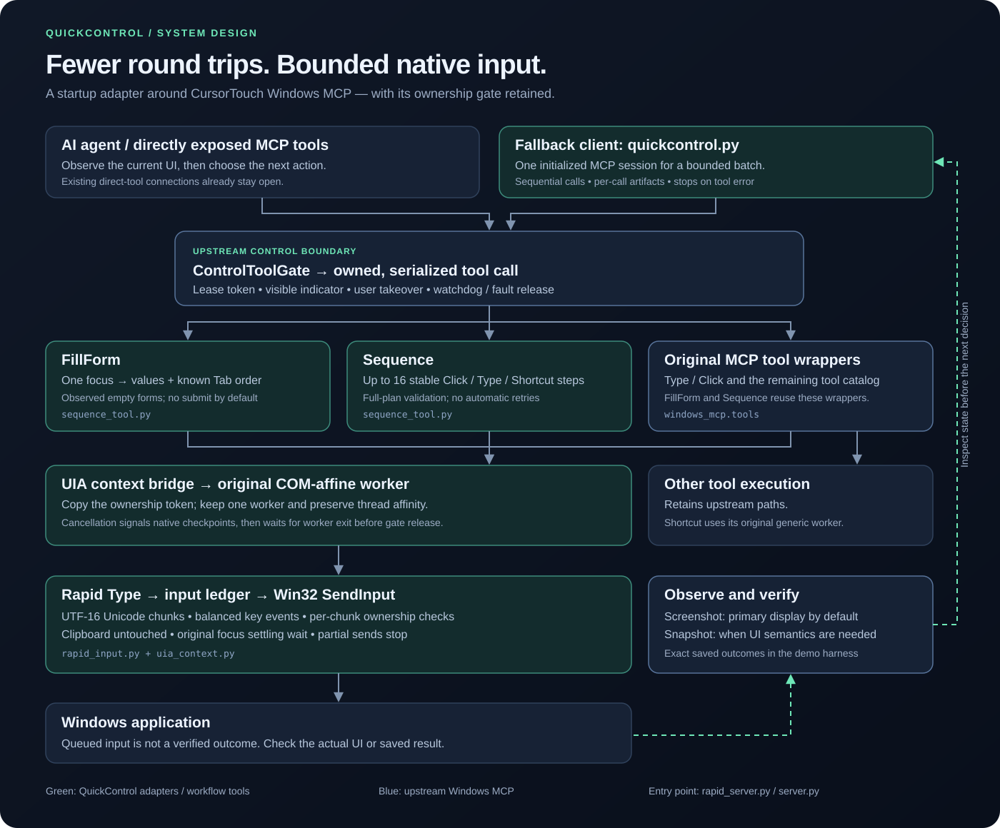

# How QuickControl executes a task

QuickControl adapts [CursorTouch Windows MCP](https://github.com/CursorTouch/Windows-MCP)
at startup. [`rapid_server.py`](../rapid_server.py) installs the control and capture
policy, UIA context bridge, native typing adapter, and additional workflow tools,
then starts the upstream server. [`server.py`](../server.py) selects that profile.
The original package files are not edited.

## From observation to input

1. The agent observes the relevant display or control. Screenshot defaults to the
   actual primary monitor; explicit displays and regions remain available.
   Snapshot supplies accessibility semantics when they are needed.
2. MCP calls enter the original `ControlToolGate`. It serializes calls, establishes
   the ownership lease, and retains the indicator, takeover and watchdog paths.
3. An ordinary tool call uses its upstream wrapper. `FillForm` uses the original
   Type wrapper once, joining values with Tab for an already observed empty form
   with known keyboard order. `Sequence` invokes original Click, Type and Shortcut
   wrappers in order, with at most 16 actions and no retries.
4. UIA work goes to the existing COM-affine worker. The
   [context bridge](../uia_context.py) copies the ownership token into that worker;
   upstream `run_in_executor` dispatch otherwise loses ContextVars. Other tools
   retain their upstream execution paths, including Shortcut's generic worker.
5. [Rapid Type](../rapid_input.py) validates the text, focuses the target with the
   upstream settling wait, and emits bounded UTF-16 input batches through Win32
   `SendInput`. Surrogate pairs stay together. The clipboard is untouched.
6. The agent observes the result before making a dependent decision. Successful
   input queueing is not proof that the app accepted the intended values.

The optional [fallback client](../quickcontrol.py) also saves connection startup
cost when a shell would otherwise start a server for each call. It reuses one MCP
session across a bounded batch and saves timings and results. Directly exposed
MCP tools already keep a connection open; client reuse adds no new advantage
there. Client batches and the server-side Sequence tool are separate mechanisms.

## Ownership, interruption, and failures

Native input checks request cancellation and control ownership before bounded
steps. The input ledger guards injection and retains cleanup for unmatched
key-down events after a partial send. A partial batch raises without replaying
text. Cleanup respects physical key-downs delivered after user takeover.

Cancelling native UIA input sets a per-invocation event. The bridge waits for its
worker to stop before returning cancellation to the control gate. An in-flight
native API call may finish; cancellation prevents subsequent input checkpoints
from proceeding. This does not forcibly terminate a blocked native API or add
cooperative checks inside arbitrary upstream Shortcut operations.

Double-tap Escape uses the existing handoff path. Ordinary physical input does
not interrupt an active lease under the requested control profile. Upstream
fault release and watchdog behavior remain. Simulated hook tests do not replace
a physical keyboard check of the Escape gesture.

FillForm does not inspect or discover tab order. Its default leaves focus on the
last field. Explicit submission adds one trailing Tab and Enter; use that option
only after observing that the next control is the intended Save/Submit button.
Sequence must not span changing layouts or steps needing an intermediate
decision. Neither tool rolls back completed input.

## What the measurements establish

The [saved R&D report](../measurements/rd-report.md) records local browser-fixture
tasks and a real Notepad edit/save task. Three selected runs per profile and task
passed independent exact outcome checks. The largest improvement combines
native input with one observed keyboard traversal of an eight-field form.
The baseline instead focuses each field separately. This measures the combined
workflow and typing change, rather than isolating the input backend.

Warm task timing excludes startup, application launch, navigation, initial
observation and model reasoning. The browser tasks use fictional local fixtures;
they do not establish third-party website compatibility. The report retains
failed experiments and cohort limitations. There is no separately measured
speedup claim for Sequence, cancellation, or the architecture itself.
